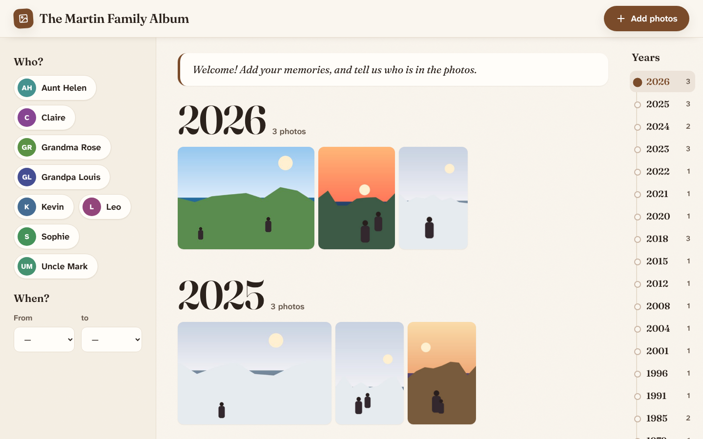
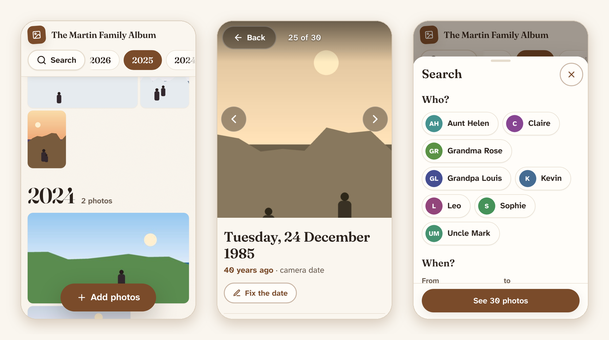
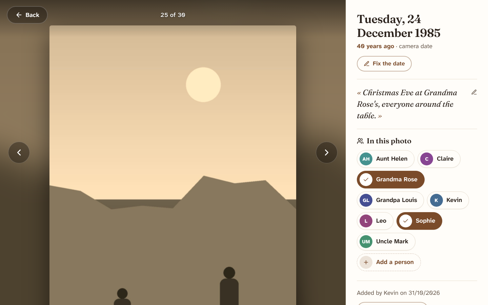

<div align="center">

# Photos de famille

**A private, easy-to-use family photo album that you host yourself, for free.**

Add photos from your phone, scroll back through the years, and tag who's in each picture.
Made for the whole family, grandparents included.

[](https://github.com/drmeph/photos-de-famille/actions/workflows/deploy.yml)
[](LICENSE)

</div>



## Why

Family photos end up scattered across phones, shoeboxes and group chats. This project gives a
family one shared place for them that:

- **is simple enough for everyone**: one big "Add photos" button, large text, no menus to learn;
- **stays private**: only the people you invite can get in, with no account to create and no
  password to remember (they receive a code by email);
- **belongs to you**: the photos live in your own Cloudflare account, not on a service that might
  change its terms or shut down;
- **costs nothing** for a typical family (see [cost](#cost)).

## Features

- **Add photos** from the camera or the photo library, or on a computer by dragging several
  in from a folder. iPhone HEIC photos work, and the same photo added twice is detected.
- **A timeline by year and month**, using the date each photo was taken. Months with only a
  photo or two sit side by side, so sparse old years stay compact. Old scans with a wrong date
  can be corrected by anyone.
- **Latest additions**: switch between "By date" and "Latest additions" to see what the family
  added recently, grouped by day ("Today", "Yesterday"…) and by who added the photos.
- **Everyone has a name**: on their first visit, people choose the first name shown on the
  photos they add and with their comments.
- **Comments** under each photo, to share memories ("that was the year of the big snow…").
  Photos with comments show a small 💬 badge in the timeline.
- **Who's in it**: tap names to tag people. The whole family can help identify faces.
- **Search** by one or more people and a range of years.
- **Captions**, a short change history on each photo, and the original file always downloadable.
- **Designed for older eyes**: big buttons and text, the
  [Atkinson Hyperlegible](https://www.brailleinstitute.org/freefont/) font made for readers with
  low vision, and nothing that relies on hovering with a mouse.
- **Phone, tablet and computer**, and it can be added to a phone's home screen like an app.
- **Your family's album**: set its name, language (French or English), color and a welcome
  message, with no code changes.

<p align="center">
  
</p>



## How it works

```
 Phone or computer                Cloudflare
┌────────────────────┐        ┌───────────────────────────────────────────────┐
│ The album app      │ ─────▶ │ Access: email code, only invited family       │
│ • shrinks photos   │        │   │                                           │
│ • reads the date   │        │ Pages: the app + a small API ────▶ R2 storage │
│ • converts HEIC    │        │                                photos + JSON  │
└────────────────────┘        └───────────────────────────────────────────────┘
```

The phone does the image work (resizing, reading dates, converting HEIC) before uploading, so
the server stays tiny: a few API routes on Cloudflare Pages that store files in R2. There's no
database and no server to maintain. Tags, dates and captions are plain JSON files next to the
photos, so your archive stays readable without this project.

More detail in [docs/ARCHITECTURE.md](docs/ARCHITECTURE.md).

## Get your own album

You need a free [Cloudflare account](https://dash.cloudflare.com/sign-up), a GitHub account,
and [Node.js](https://nodejs.org) 22 or newer on your computer for the setup commands.

1. **Fork** this repository.
2. **Create the storage bucket and the Pages project** with two `wrangler` commands.
3. **Set up sign-in** with Cloudflare Access and list your family's email addresses.
4. **Personalize it** (optional): album name, language, color, welcome message.
5. **Deploy**: every push to `main` deploys automatically through GitHub Actions.

**[docs/DEPLOY.md](docs/DEPLOY.md) walks through every step** (about 30 minutes). It also
covers using your own domain, inviting relatives, backups and troubleshooting.

### Cost

Everything fits in Cloudflare's free plans at family scale:

| Service | Free | Beyond that |
|---|---|---|
| R2 storage | 10 GB (about 2,500 phone photos with their thumbnails) | about $0.015 per GB per month; viewing photos costs nothing extra |
| Pages | 100,000 requests a day | far more than a family uses |
| Access (sign-in) | up to 50 people | |

Cloudflare asks for a payment method on file when you enable R2, even if you stay within the
free tier.

## Make it yours

Four optional settings, set as Cloudflare secrets so nothing about your family ends up in the
code. They apply on the next deploy, with no rebuild needed.

| Setting | What it does | Example |
|---|---|---|
| `ALBUM_TITLE` | Name in the header, browser tab and home-screen icon | `The Martin Family Album` |
| `ALBUM_LANGUAGE` | `fr`, `en`, or `auto` (follows each visitor's phone) | `fr` |
| `ALBUM_COLOR` | The album's color: buttons, highlights, and a light tint across the page | `#1f4e79` |
| `ALBUM_WELCOME` | Short message at the top of the album | `Welcome! Questions? Call Kevin.` |

Details in [docs/CONFIGURATION.md](docs/CONFIGURATION.md).

## Local development

```sh
git clone https://github.com/drmeph/photos-de-famille.git
cd photos-de-famille
npm install                      # Node.js 22+ (`nvm use` reads .nvmrc)
cp .dev.vars.example .dev.vars   # local-only settings: skips sign-in, sets a demo user
npm run dev                      # http://localhost:8788
```

`npm run dev` rebuilds the app when you change a file (reload the page to see it) and runs the
API against a simulated R2 bucket in `.wrangler/state/`, so nothing touches Cloudflare.

```sh
npm run check   # typecheck + tests + production build (what CI runs)
```

**Stack:** [Preact](https://preactjs.com) + TypeScript, built with [Vite](https://vite.dev);
[Cloudflare Pages Functions](https://developers.cloudflare.com/pages/functions/) and
[R2](https://developers.cloudflare.com/r2/); tests with [Vitest](https://vitest.dev).

### Project structure

```
src/                Browser app
  views/              Timeline, photo page (details + tagging), upload
  components/         People chips, search panel, year navigation, icons
  lib/image.ts        HEIC decoding, EXIF date, resizing, content hash
  i18n.ts             All interface text (French and English)
  styles.css          The whole look: colors, type, responsive layout
functions/          Cloudflare Pages Functions (thin entry points)
  _middleware.ts      Sign-in check on every request; fills in the family settings
server/             API logic, framework-free so it can be unit-tested
shared/             Data model and settings shared by app and server
tests/              Vitest tests (API with an in-memory R2, sign-in, settings)
docs/               Deploy guide, configuration, sign-in, architecture
.github/workflows/  Checks every pull request; deploys every push to main
```

## Contributing

Issues and pull requests are welcome. A few principles keep the project useful for its audience:

- **Simple beats clever.** The people using this include grandparents. Large tap targets, plain
  words, no hover-only controls, no gestures that are the only way to do something.
- **No new servers or databases** unless there's no other way. The whole thing should stay
  free and maintenance-free for a family.
- **Run `npm run check`** before opening a pull request; CI runs the same command.

**Adding a language:** add a dictionary in [`src/i18n.ts`](src/i18n.ts) and its code to
`LANGUAGES` in [`shared/config.ts`](shared/config.ts).

### Not supported yet

Ideas that would fit well: deleting or hiding photos (left out of v1 on purpose, to avoid
accidents), email notifications for new comments, videos, more languages, and suggested tags
from a face-recognition batch job.

## Privacy and security

- Photos and data stay in **your** Cloudflare account.
- Every request (pages, photos, API) is checked: the site verifies the signed token from
  Cloudflare Access (signature, audience, issuer, expiry). If sign-in isn't configured, the
  site refuses everyone instead of being public.
- The resized copies shown in the album carry no location data. The original files are kept
  untouched and can be downloaded by family members.

More in [docs/AUTH.md](docs/AUTH.md) and [docs/ARCHITECTURE.md](docs/ARCHITECTURE.md#security).

## Credits

- Fonts: [Fraunces](https://github.com/undercasetype/Fraunces) and
  [Atkinson Hyperlegible Next](https://www.brailleinstitute.org/freefont/), under the SIL Open
  Font License, via [Fontsource](https://fontsource.org).
- Icons from [Lucide](https://lucide.dev) (ISC).
- [exifr](https://github.com/MikeKovarik/exifr) (MIT) reads photo dates.
  [heic-to](https://github.com/hoppergee/heic-to) (LGPL-3.0, built on libheif) converts HEIC
  photos. It's loaded as a separate file, and only when the browser can't open HEIC itself.

## License

[MIT](LICENSE) © 2026 Kevin Dorfer
